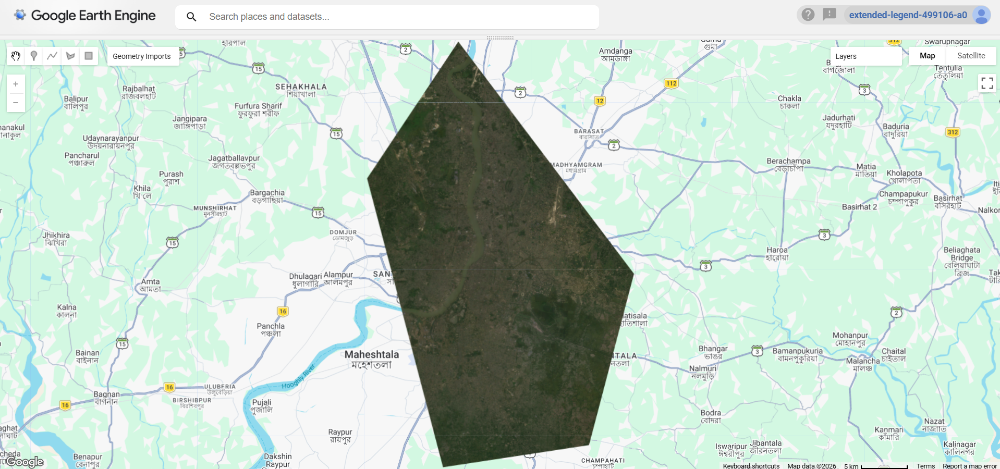
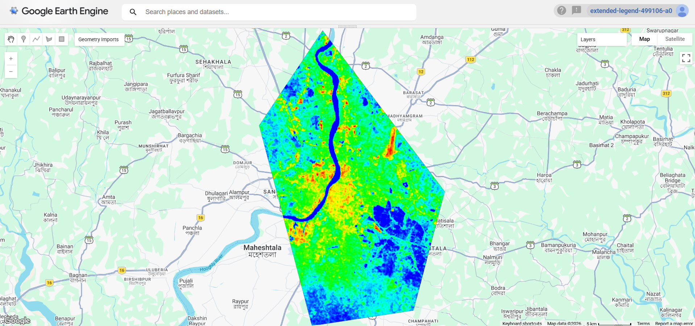
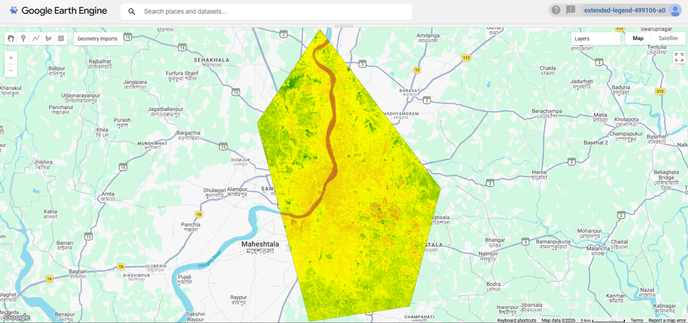
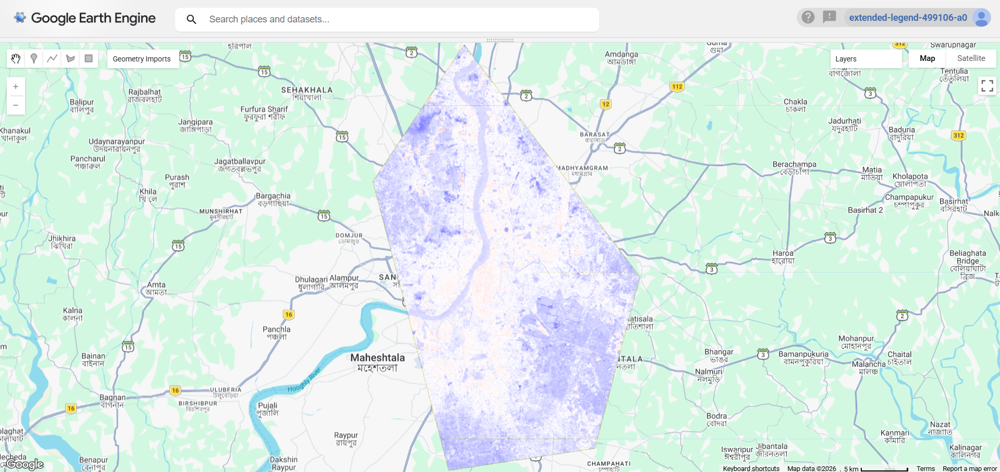
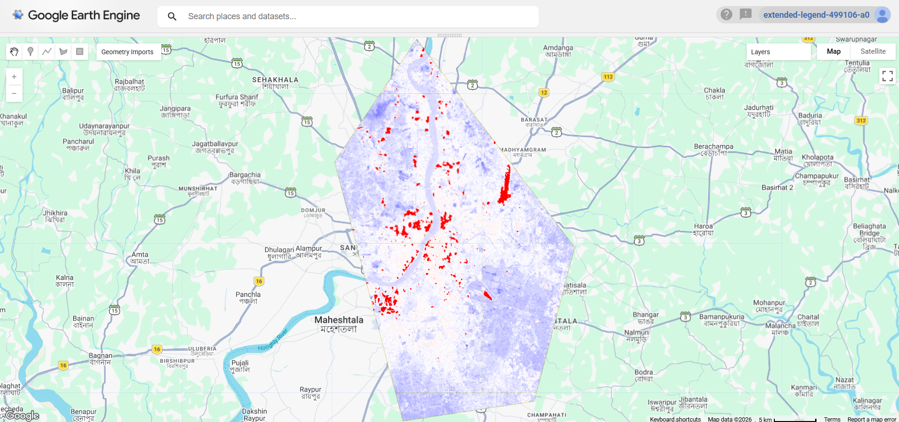
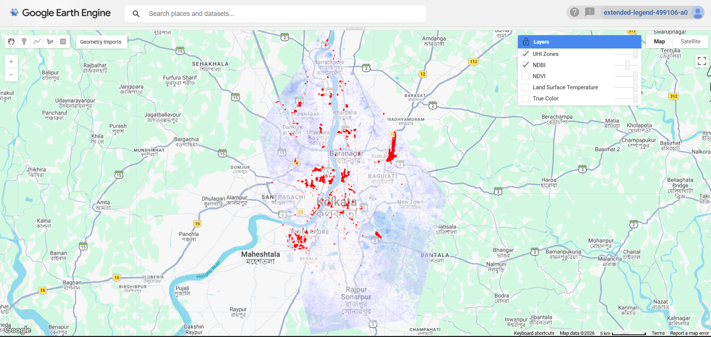
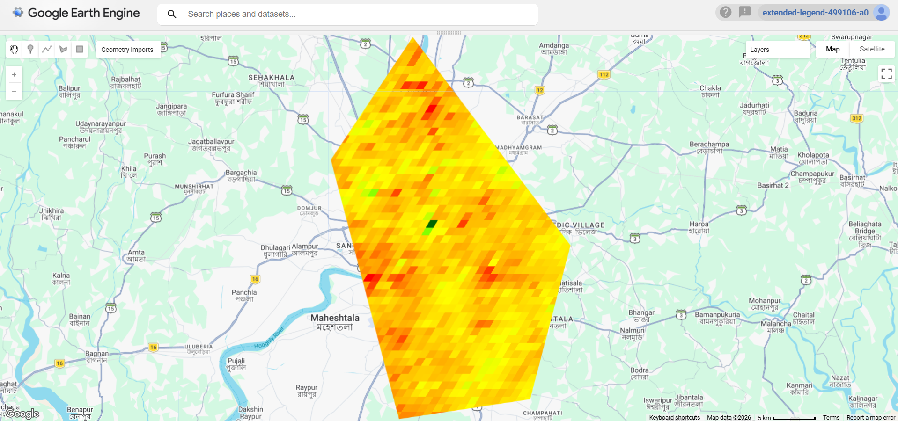
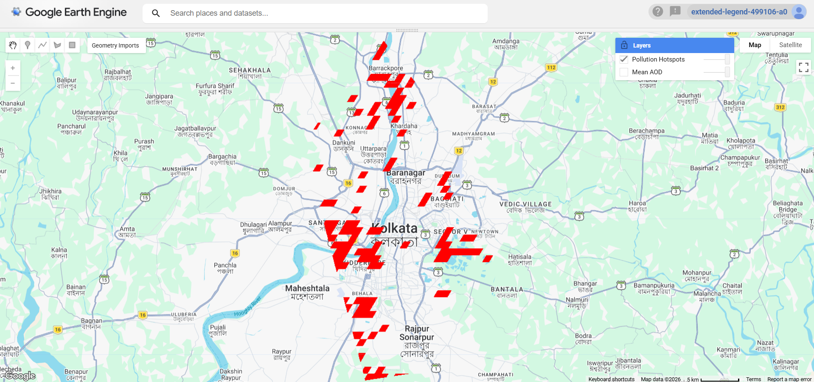

# Remote Sensing and GIS Projects — ISA Internship 2026

A collection of two remote sensing and geospatial analysis projects completed as part of the India Space Academy (ISA) Remote Sensing Internship 2026.

Both projects use **Google Earth Engine (GEE)** to process satellite imagery and analyse environmental patterns in the Kolkata region.

## Projects

### 1. Urban Heat Island Analysis

**Project Code:** P2  
**Study Area:** Kolkata Metropolitan Area

**Objective:**  
To investigate urban heat patterns using Land Surface Temperature (LST), vegetation and built-up indicators.

**Data and Methodology:**
- Landsat 8 Collection 2 Level-2 satellite imagery.
- Land Surface Temperature estimation using the thermal band.
- NDVI calculation to examine vegetation distribution.
- NDBI calculation as an indicator of built-up areas.
- Identification and area estimation of high-temperature zones.

**Technologies:** Google Earth Engine, JavaScript, Remote Sensing and GIS.

**Files:**
- [Project Report (PDF)](P2_Urban_Heat_Island/Urban%20Heat%20Island%20Report.pdf)
- [GEE Source Code (JavaScript)](P2_Urban_Heat_Island/Urban%20Heat%20Island%20Analysis.js)

#### Project Visualizations

**True Colour Composite**

**Land Surface Temperature**

**Vegetation Index**

**Built-up Index**

**Urban Heat Island Hotspots**

**UHI–NDBI Overlay**

### 2. Air Quality and Aerosol Pattern Mapping

**Project Code:** P5  
**Study Area:** Kolkata Metropolitan Area  
**Analysis Period:** November 2023

**Objective:**  
To analyse aerosol optical depth (AOD) patterns using satellite-derived observations.

**Data and Methodology:**
- MODIS MCD19A2 Version 6.1 satellite dataset.
- Analysis of the `Optical_Depth_047` band.
- Monthly mean AOD composite generation.
- Statistical analysis of AOD values.
- Identification and area estimation of high-AOD zones.

**Technologies:** Google Earth Engine, JavaScript, Remote Sensing and GIS.

**Files:**
- [Project Report (PDF)](P5_Air_Quality/Air%20Quality%20AOD%20Report.pdf)
- [GEE Source Code (JavaScript)](P5_Air_Quality/Air%20Quality%20AOD%20Analysis.js)

#### Project Visualizations

**Mean Aerosol Optical Depth**

**Pollution Hotspots**

## Tools and Technologies

- Google Earth Engine (GEE)
- JavaScript
- Landsat 8 satellite imagery
- MODIS satellite data
- Remote Sensing and Geospatial Analysis

## About

These projects provided practical experience in satellite data processing, geospatial analysis, environmental monitoring and working with cloud-based geospatial tools.

Completed as part of the **India Space Academy Remote Sensing Internship 2026**.
